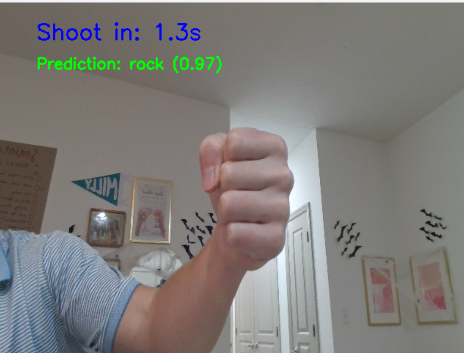
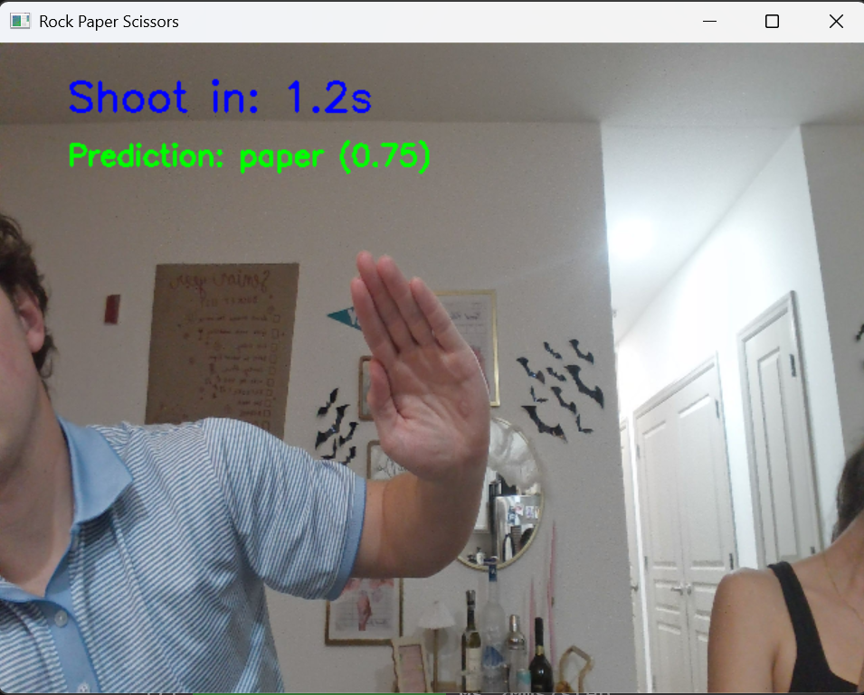
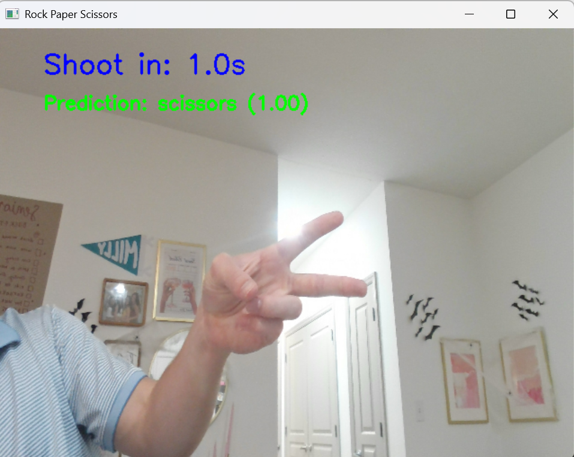
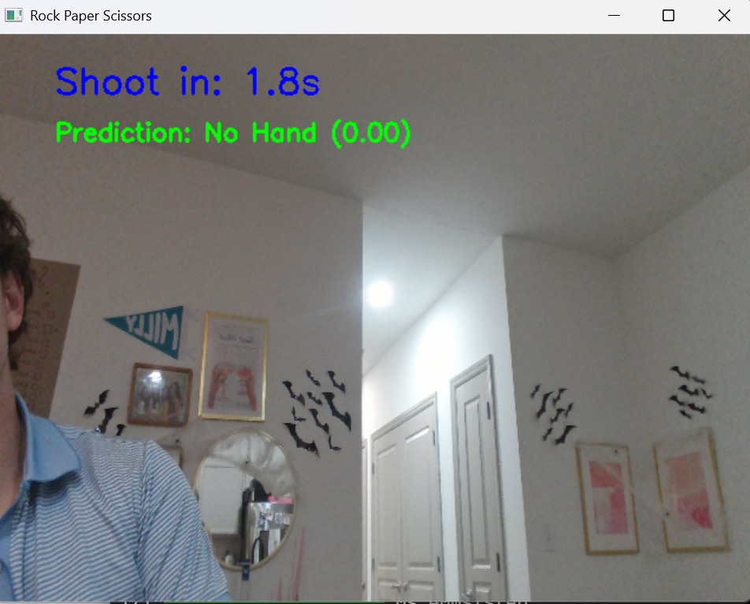

# Real-Time Rock-Paper-Scissors Gesture Detector

A real-time hand gesture classifier for Rock, Paper, and Scissors, built with Python, OpenCV, MediaPipe, and TensorFlow/Keras. It reads a webcam feed, labels your gesture live, and plays a round against a random computer move.

| Rock | Paper | Scissors | No Hand
|:---:|:---:|:---:|:---:|
|  |  |  |  |

This project was an end-to-end exercise in applied computer vision: collecting data, training a CNN, and running real-time inference. It is a working proof of concept. It works live on my own hand, but I have not measured its accuracy on unseen data (see Limitations), so I do not report an accuracy number.

## Two pipelines

| Pipeline | Script | Model input | Training data |
|---|---|---|---|
| Raw image | `run_rps_game.py` | Full webcam crop | 400 images per class, my hand, simple backgrounds |
| Segmented hand | `run_rps_game_with_segmentation.py` | Hand isolated on a black background | The same images, run through `process_existing_images.py` (up to 400 per class) |

The segmented pipeline uses MediaPipe's `HandLandmarker` and `ImageSegmenter` to cut out the hand before classification. I built it to address the background problem described below. The segmented dataset is not new data: `process_existing_images.py` converts each image in the raw dataset, and a separate model was trained on the result. In informal real-time testing, the segmented pipeline was more consistent than the raw one. I did not run a formal comparison.

## How it works

1. **Data collection** (`Collect_DataScript.py`): a 300x300 region of the webcam frame is saved as the user presses a key, one folder per class.
2. **Segmentation** (`process_existing_images.py`, segmented model only): MediaPipe `HandLandmarker` finds the hand and a padded bounding box is cropped. MediaPipe `ImageSegmenter` (multiclass selfie model) then keeps pixels with a body-skin confidence above 0.5 and sets everything else to black. Images where no hand is detected or segmentation fails are skipped.
3. **Preprocessing:** images are resized to 150x150.
4. **Model** (`train_model.py`): a small CNN with three convolution + max-pooling blocks (32, 64, 128 filters), a 512-unit dense layer, and a 3-way softmax. Training uses Adam (learning rate 1e-4) for 50 epochs with an 80/20 train/validation split.
5. **Augmentation** (training only, raw model): random rotation (up to 0.2 of a full turn, about ±72°), zoom and translation (up to 20%), and horizontal flip.
6. **Game loop:** each round has a 3-second countdown, then 3 seconds showing the result against a random computer move. The raw pipeline classifies the fixed 300x300 box on every frame during the countdown. The segmented pipeline finds the hand anywhere in the 640x480 frame and processes every third frame to keep the display smooth. The last prediction before the countdown ends is the player's move.

The segmented model uses the same script with `DATA_DIR` pointing at `processed_data`, with augmentation commented out and one convolution and max-pooling layer removed.

## Speed

Measured on CPU (AMD Ryzen 7 PRO 8840U, 32 GB RAM) over several rounds of live play. Times exclude reading the webcam frame and drawing the display.

| Stage | Raw pipeline | Segmented pipeline |
|---|---:|---:|
| Hand detection (MediaPipe) | — | 19 ms |
| Hand segmentation (MediaPipe) | — | 108 ms |
| CNN prediction (Keras `predict`) | 49 ms | 59 ms |
| **Total per classified frame** | **53 ms** | **186 ms** |
| Frames measured | 468 | 261 |

Values are medians. The first prediction in each run is much slower (up to about 450 ms) while TensorFlow warms up.

The raw pipeline can classify roughly 19 frames per second. The segmented pipeline classifies about 5 frames per second, and segmentation accounts for most of its time (about 58%). Possible speedups: calling the model directly instead of `model.predict` for single images, a lighter segmentation step, or skipping segmentation and classifying the hand landmarks directly.

## Tech stack

Python, OpenCV, MediaPipe, TensorFlow/Keras, NumPy, Matplotlib

## Limitations

- **Single-person dataset.** Both models were trained only on my own hand, so they may not generalize to other hand shapes, sizes, or skin tones.
- **Little background variation.** The raw-image training data used a few simple backgrounds, so that model likely learned parts of my room and lighting along with the gesture. Augmentation helped, but some errors remained in new environments.
- **Near-duplicate images.** I collected data by holding a key down, which produced bursts of nearly identical frames (often shifted by a few pixels). This lowers the effective dataset size well below 400 per class.
- **Leaky validation split.** The validation set is a random 20% of the same images (`validation_split=0.2`), so near-copies of training images appear in validation. Validation accuracy therefore overstates real-world performance, and I do not report it.
- **Imperfect segmentation masks.** The mask is a simple 0.5 threshold on the model's skin confidence, so some segmented training images have small holes in the hand. I did not clean or filter them. Because the segmented set is derived from the raw set, it also inherits the same near-duplicates, the single-person limit, and the leaky split.
- **Fixed framing.** Every sample is a 300x300 crop with the hand centered, so the models may struggle with other positions or scales.

## Future improvements

- Collect a larger, more varied dataset (raw and segmented) from multiple people, backgrounds, and lighting conditions. This is the highest priority.
- Collect on a timer (about one frame every half second, varying pose and position) instead of holding a key, to avoid near-duplicates.
- Split by capture session or person so the validation set contains no near-copies of training images, and report per-class accuracy on a truly held-out set.
- Clean or filter segmentation masks (for example by checking for holes or tiny masks) before training.
- Try other architectures (for example MobileNetV2 for edge devices) and tune hyperparameters.

The main lesson: data collection decided this project’s results more than the model did. Next time I’d design the dataset and test split before training anything.

## Setup and usage

Trained models (`image_classification_model.h5`, `image_classification_model2.h5`, etc.) are not included because of their size. To retrain, collect data with `Collect_DataScript.py` into `data/`, run `process_existing_images.py` to produce `processed_data/` (it needs the MediaPipe `hand_landmarker.task` and `selfie_multiclass_256x256.tflite` model files in the repo folder), and then run `train_model.py`.

```bash
git clone https://github.com/zachbs/opencv-rps-gesture-detector.git
cd opencv-rps-gesture-detector
pip install -r requirements.txt
```

The segmented pipeline also needs two MediaPipe model files from Google. Download them into the repo folder:

```bash
curl -L -o hand_landmarker.task https://storage.googleapis.com/mediapipe-models/hand_landmarker/hand_landmarker/float16/1/hand_landmarker.task
curl -L -o selfie_multiclass_256x256.tflite https://storage.googleapis.com/mediapipe-models/image_segmenter/selfie_multiclass_256x256/float32/latest/selfie_multiclass_256x256.tflite
```

On Windows PowerShell, use `curl.exe` instead of `curl`.

```bash
python run_rps_game.py                      # raw-image model
python run_rps_game_with_segmentation.py    # segmented model
```

A webcam is required.
